  

  

  
  

  

  

---

### 🚀 About Me

- 🔭 Currently building **[Kepler Orrery](https://github.com/shanshantanusingh113-max/kepler-orrery)**: a live 3D Solar System Lab with planetary science tools, all in the browser
- 🌱 Learning **C++** in depth
- 🤖 Exploring **AI**, and always happy to learn from people working in it
- 💬 Ask me about **collaboration** and **tech support**
- 📍 Based in **India**

### 🛠️ Tech Stack

  

### 📂 Projects

<!-- PROJECTS:START -->
| Project | Description | Language | ⭐ | Updated |
|---|---|---|:-:|---|
| [**kepler-orrery**](https://github.com/shanshantanusingh113-max/kepler-orrery) | Solar System Lab: live 3D orrery plus four planetary science tools, all in the browser | HTML | 0 | today |
| [**jss-university-noida-3d-tour**](https://github.com/shanshantanusingh113-max/jss-university-noida-3d-tour) | — | HTML | 0 | 3d ago |
| [**ledgerlens**](https://github.com/shanshantanusingh113-max/ledgerlens) | AI copilot for Indian GST reconciliation: every mismatch priced as ITC at risk or ITC found, each Finding explained with evidence, a Draft fix approved in one click, and Supplier rings caught on the network view | Python | 0 | 14d ago |
| [**shantanu-ai-craft-74b8b692**](https://github.com/shanshantanusingh113-max/shantanu-ai-craft-74b8b692) | — | TypeScript | 0 | 23d ago |
| [**samudra-sih26**](https://github.com/shanshantanusingh113-max/samudra-sih26) | — | Python | 1 | 1mo ago |
| [**jansetu-ai**](https://github.com/shanshantanusingh113-max/jansetu-ai) | JanSetu AI - Multilingual citizen grievance routing system (React + FastAPI + ML) with the Corsair Edition animated design | JavaScript | 0 | 1mo ago |
| [**shantanu-ai-craft**](https://github.com/shanshantanusingh113-max/shantanu-ai-craft) | — | TypeScript | 1 | 1mo ago |
| [**sih26067-samudra**](https://github.com/shanshantanusingh113-max/sih26067-samudra) | SAMUDRA - SIH26067 web-based interactive 3D ocean data visualization platform (INCOIS): WOA23 fields + Argo/Glider/BGC observations + HYCOM currents | TypeScript | 0 | 1mo ago |
| [**Echo-hertiage**](https://github.com/shanshantanusingh113-max/Echo-hertiage) | — | JavaScript | 0 | 2mo ago |
| [**child-devlop-2**](https://github.com/shanshantanusingh113-max/child-devlop-2) | — | TypeScript | 0 | 2mo ago |
| [**portfolio**](https://github.com/shanshantanusingh113-max/portfolio) | — | TypeScript | 0 | 2mo ago |
| [**child-dev-intelligence**](https://github.com/shanshantanusingh113-max/child-dev-intelligence) | — | TypeScript | 0 | 2mo ago |
| [**Hacklt**](https://github.com/shanshantanusingh113-max/Hacklt) | — | JavaScript | 0 | 2mo ago |
| [**airiq-city**](https://github.com/shanshantanusingh113-max/airiq-city) | AI powered urban air quality intelligence for smart city intervention | — | 0 | 3mo ago |
| [**HealthConnect-AI**](https://github.com/shanshantanusingh113-max/HealthConnect-AI) | AI-powered responsive healthcare platform prototype for connected, accessible and preventive care | HTML | 0 | 3mo ago |
| [**muleshield**](https://github.com/shanshantanusingh113-max/muleshield) | — | JavaScript | 0 | 4mo ago |
| [**Codebase-Cartographer**](https://github.com/shanshantanusingh113-max/Codebase-Cartographer) | — | Python | 0 | 5mo ago |
| [**face-attendance-app**](https://github.com/shanshantanusingh113-max/face-attendance-app) | — | JavaScript | 1 | 5mo ago |
| [**HeyConvo**](https://github.com/shanshantanusingh113-max/HeyConvo) · [demo](https://hey-convo.vercel.app) | — | JavaScript | 1 | 6mo ago |
| [**Pdf-to-audiobook**](https://github.com/shanshantanusingh113-max/Pdf-to-audiobook) | — | Python | 1 | 6mo ago |
| [**report**](https://github.com/shanshantanusingh113-max/report) | — | — | 0 | 6mo ago |
| [**Shantanu-singh**](https://github.com/shanshantanusingh113-max/Shantanu-singh) | — | — | 0 | 9mo ago |
<!-- PROJECTS:END -->

### 📊 GitHub Stats

  
  

  

  

### 🐍 Contribution Snake

  <picture>
    <source media="(prefers-color-scheme: dark)" srcset="https://raw.githubusercontent.com/shanshantanusingh113-max/shanshantanusingh113-max/output/github-snake-dark.svg"/>
    
  </picture>

  

